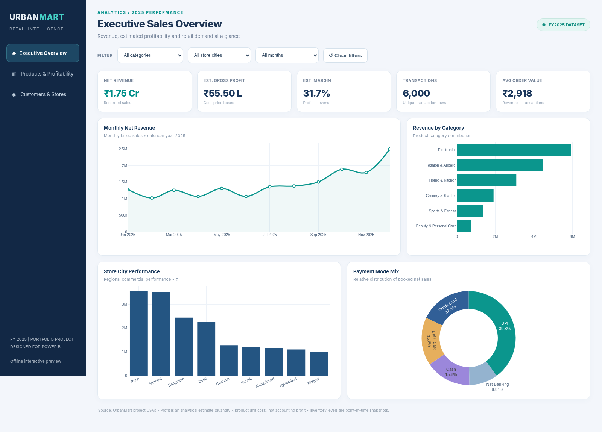
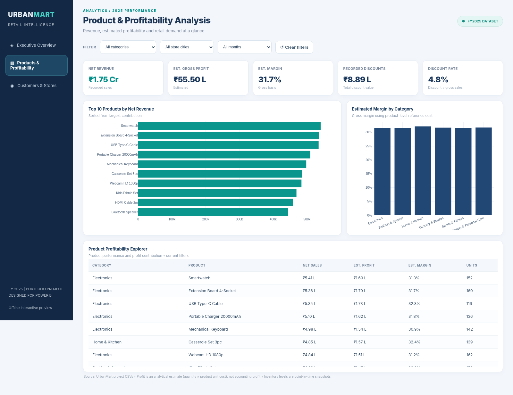
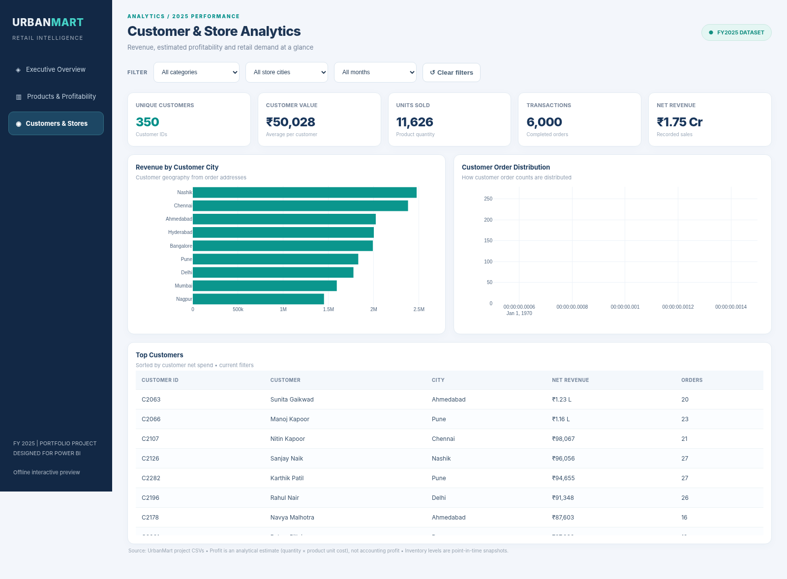

# Power BI Dashboard — UrbanMart

This folder contains the Power BI setup resources and the location for the complete report package.

## Download and open

1. Download [UrbanMart_Professional_PowerBI_Dashboard.zip](UrbanMart_Professional_PowerBI_Dashboard.zip) from this folder.
2. Extract the ZIP into a local Windows folder, keeping the project folders together.
3. Open `UrbanMart_Retail_Analytics.pbip` in a recent version of **Power BI Desktop**. Do **not** open the individual .pbip descriptor in this repository without its companion folders.
4. Confirm that **Executive Overview**, **Products & Profitability**, and **Customers & Stores** load and respond to filters.
5. Under **View → Themes → Browse for themes**, select `UrbanMart_Theme.json` if needed.
6. Once verified, save a `.pbix` in Power BI Desktop if you want a single-file report.

The ZIP includes the required `.Report` and `.SemanticModel` directories, sample CSVs, custom theme, DAX reference, three preview screenshots and an **independent offline HTML preview**.

## Dashboard metrics

| Measure | Definition |
|---|---|
| Net Revenue | SUM of recorded net sales |
| Estimated COGS | Quantity × reference product cost |
| Estimated Gross Profit | Net Revenue − Estimated COGS |
| Estimated Profit Margin | Estimated Gross Profit / Net Revenue |
| Transactions | Distinct transaction IDs |
| Customers | Distinct customer IDs |
| Average Order Value | Revenue / Transactions |
| Discount Rate | Discounts / Gross Sales |

> **Important:** Costs are reference product costs. Gross profit and margin are estimates, not audited or transaction-recorded profitability.
>
> **Compatibility:** This programmatically generated PBIP was not opened and tested in Power BI Desktop. The independent HTML preview was tested; the Desktop report still requires validation.

## Supporting assets

- [Theme](UrbanMart_Theme.json)
- [DAX measures](DAX_Measures.md)
- [PBIP descriptor](UrbanMart_Retail_Analytics.pbip) (**not standalone**)
## Report screenshots

### Executive Overview

### Products & Profitability

### Customers & Stores

